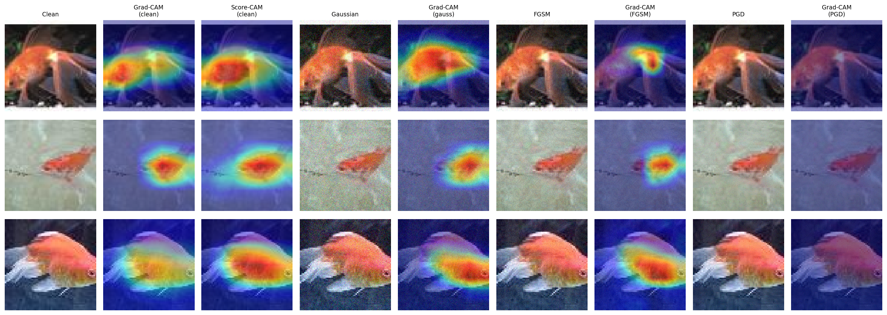
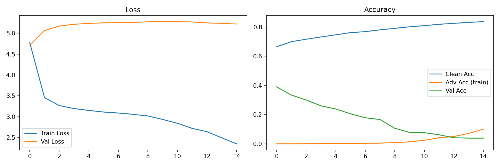

# Adversarial Robustness of CNNs

**Comparative Analysis of Gaussian Noise and Adversarial Attacks, Defense Strategies, and Explainability with Grad-CAM & Score-CAM**

CSI 5170/4170 Machine Learning · Fall 2026 · Oakland University, School of Engineering and Computer Science
Author: **Abhijeet Bhattacharya** ([bhattacharya@oakland.edu](mailto:bhattacharya@oakland.edu))

📄 **Report:** [`CSI5170_Phase2_Writeup.pdf`](CSI5170_Phase2_Writeup.pdf)

---

## Overview

This project measures how a transfer-learned **ResNet-50** classifier on **Tiny ImageNet** (200 classes) breaks under random and adversarial perturbations, which defenses help, and whether the model's visual explanations stay trustworthy when the input is attacked.

| | |
|---|---|
| **Perturbations** | Gaussian noise (σ = 0.05 / 0.10 / 0.20) · FGSM (ε = 8/255) · PGD (ε = 8/255, α = 2/255, 7 steps) |
| **Defenses** | Noise-augmented training · Adversarial training (PGD, ε-curriculum) · Test-time denoising (Gaussian / median filter) |
| **Explainability** | Grad-CAM · Score-CAM, scored with Average Drop %, Increase in Confidence %, and heatmap stability |

### Research questions

1. **RQ1:** How much does Gaussian noise degrade accuracy compared with adversarial attacks?
2. **RQ2:** Which defenses are effective against each perturbation type?
3. **RQ3:** Do Grad-CAM and Score-CAM differ, and which is more faithful and stable?

## Pipeline

```
Tiny ImageNet ──► Preprocess ──► ResNet-50 transfer learning ──┬──► Perturbations (Gaussian / FGSM / PGD) ──┐
 (64×64, 200 cls)  224×224, [0,1]   head → fine-tune           └──► Defenses (noise-aug / AT / denoise) ──┴──► Robustness eval ──► Grad-CAM / Score-CAM
```

- Images are upscaled 64 → 224 and scaled to **[0, 1]**. ImageNet "caffe" preprocessing is built into the model's first layers, so attacks and ε budgets operate directly in pixel space.
- The baseline is trained in two stages: (A) head only with a frozen backbone, then (B) fine-tuning from layer 140.
- All perturbations are generated on the fly. Evaluation uses a fixed, seeded subset of 960 validation images.

## Results

### White-box robustness (top-1 accuracy, 960 val images)

FGSM and PGD are crafted **against each evaluated model** (white-box).

| Model | Clean | Gauss σ=0.05 | Gauss σ=0.10 | Gauss σ=0.20 | FGSM | PGD |
|---|---:|---:|---:|---:|---:|---:|
| Baseline | 0.6812 | 0.5906 | 0.4708 | 0.1979 | 0.0229 | 0.0000 |
| Noise-Augmented | 0.6500 | 0.6427 | **0.6542** | **0.5240** | 0.0250 | 0.0000 |
| Adversarial (final, v3) | ≈0.62 † | — ‡ | — ‡ | — ‡ | — ‡ | **≈0.13** † |

† Author-reported values for the final v3 model; not yet written to `results/`.
‡ Not re-measured after final training. The Adversarial row currently in `results/robustness_comparison.csv` belongs to a superseded checkpoint (see below). Re-run `eval_only.py` to refresh it.

### Test-time denoising (PGD → Gaussian filter, σ = 1.0)

| Model | PGD | PGD + denoise | Gain |
|---|---:|---:|---:|
| Baseline | 0.0000 | 0.2281 | +0.2281 |
| Noise-Augmented | 0.0000 | 0.2323 | +0.2323 |

The attack is not aware of the filter, so these gains are an upper bound.

### Explainability (baseline model)

| Method | Avg. Drop % ↓ | Increase in Conf. % ↑ | Stability ↑ |
|---|---:|---:|---:|
| Grad-CAM | 29.039 | 25.000 | 0.826 |
| Score-CAM | **9.042** | **33.333** | **0.979** |



### Key findings

- **RQ1:** Random noise has to be large to hurt (σ = 0.20 → 19.8%), while a well-aimed perturbation of at most 8/255 per pixel takes the baseline to 2.3% (FGSM) and 0% (PGD).
- **RQ2:** Noise augmentation fixes Gaussian noise (σ = 0.20: 19.8% → 52.4%) but gives no adversarial robustness. Adversarial training trades about 6 points of clean accuracy for non-zero PGD robustness. Denoising recovers about 23 points against a non-adaptive PGD attack.
- **RQ3:** Score-CAM is more faithful and much more stable than Grad-CAM, at the cost of about 256 forward passes per image.

### Adversarial training: what failed and what worked

| Run | Setup | Outcome |
|---|---|---|
| 1 | BatchNorm trainable (`final_project.py`) | BN statistics drifted; clean val accuracy collapsed from ≈0.39 to ≈0.04 |
| 2 | BN frozen, top block only (`retrain_adversarial.py`) | Clean accuracy kept (0.7083) but **brittle**: σ = 0.05 → 0.0271, PGD → 0 |
| 3 | **v3:** BN frozen, full backbone, 50/50 clean+adv loss, PGD ε-curriculum 0 → 8/255, checkpoint on robust-val (`retrain_adversarial_v3.py`) | Expected trade-off: clean ≈0.62, PGD ≈0.13 |

<p align="center"></p>

### Qualitative recovery (transfer, illustrative only)

> These figures show attacks crafted on the **baseline** and then shown to the defended model. They illustrate how attention recovers; they do **not** measure white-box robustness.

| Perturbation | Defense | Recovered |
|---|---|---:|
| Gaussian σ = 0.10 | Noise-Augmented | 5 / 5 |
| FGSM ε = 8/255 | Adversarial | 23 / 24 |
| PGD ε = 8/255 | Adversarial | 27 / 28 |

See [`results/qualitative/`](results/qualitative/) for the full figures.

## Repository structure

```
├── final_project.py            # Full pipeline: data download, baseline, noise-aug, adversarial training, evaluation
├── Final_Project.ipynb         # Notebook version of the pipeline
├── retrain_adversarial.py      # AT run 2 (BN frozen, top block only)
├── retrain_adversarial_v3.py   # AT run 3 / final (full backbone, ε-curriculum)
├── eval_only.py                # Re-runs every evaluation from saved checkpoints
├── qualitative_results.py      # Builds the transfer-recovery figures
├── results/                    # CSVs, RESULTS_SUMMARY.md, figures
├── CSI5170_Phase2_Writeup.pdf  # Phase 2 report (HTML source alongside)
└── .gitignore                  # excludes models/ and tiny-imagenet-200/
```

## Reproducing

**Requirements:** Python 3.10, TensorFlow 2 (Keras 3), and a CUDA GPU (developed on 2× NVIDIA RTX 6000 Ada, 48 GB).

```bash
pip install tensorflow numpy scipy pandas matplotlib tqdm
```

1. **Data and training:** run `final_project.py` (or the notebook) top to bottom. It downloads Tiny ImageNet from `cs231n.stanford.edu`, reorganizes the validation folder, and trains the baseline and noise-augmented models into `models/`.
2. **Final adversarial model:** `python retrain_adversarial_v3.py` (warm-starts from the baseline; about 25–30 min per epoch).
3. **Evaluation:** `python eval_only.py` regenerates every CSV in `results/` plus the explainability gallery.
4. **Qualitative figures:** `python qualitative_results.py`.

Dataset (≈411 MB) and model checkpoints (≈727 MB) are not tracked in git.

## References

- Le & Yang, *Tiny ImageNet Visual Recognition Challenge*, CS231n, 2015.
- He et al., *Deep Residual Learning for Image Recognition*, CVPR 2016.
- Goodfellow et al., *Explaining and Harnessing Adversarial Examples*, ICLR 2015.
- Madry et al., *Towards Deep Learning Models Resistant to Adversarial Attacks*, ICLR 2018.
- Selvaraju et al., *Grad-CAM*, ICCV 2017.
- Wang et al., *Score-CAM*, CVPR Workshops 2020.
- Chattopadhay et al., *Grad-CAM++*, WACV 2018.
- Tsipras et al., *Robustness May Be at Odds with Accuracy*, ICLR 2019.

Full citations are in the [report](CSI5170_Phase2_Writeup.pdf).
